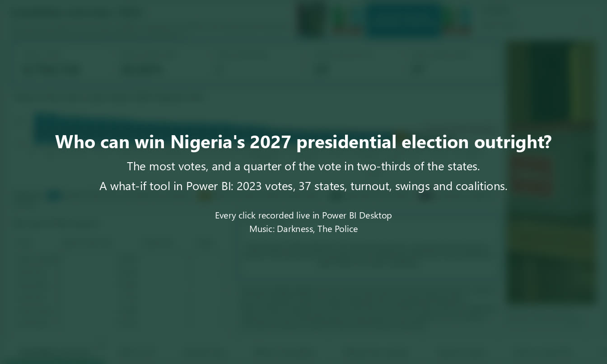
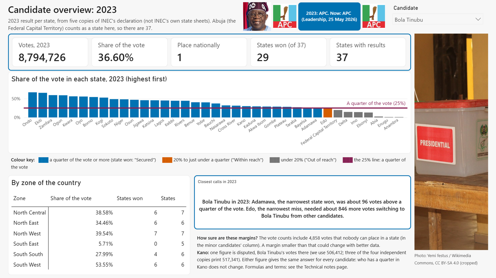
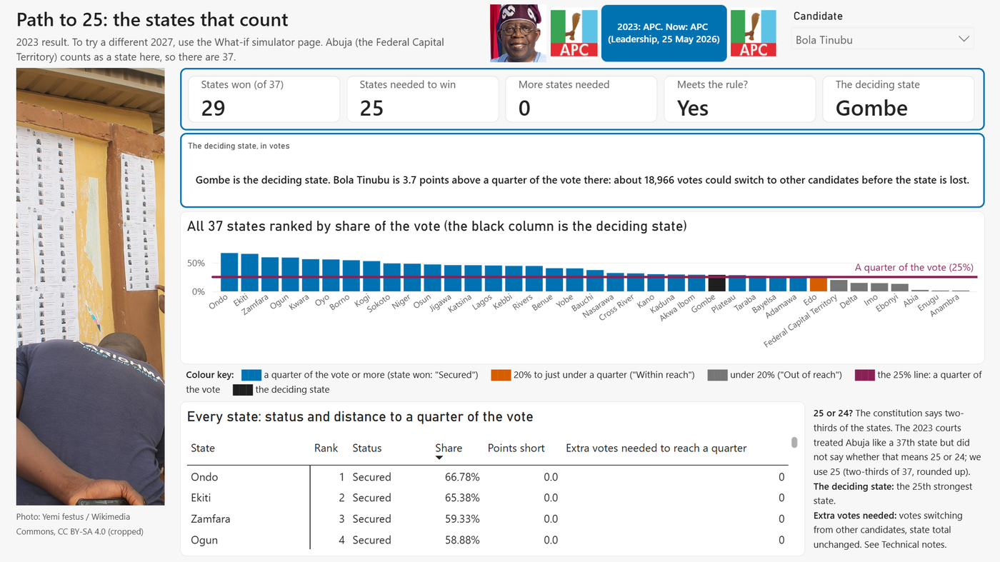
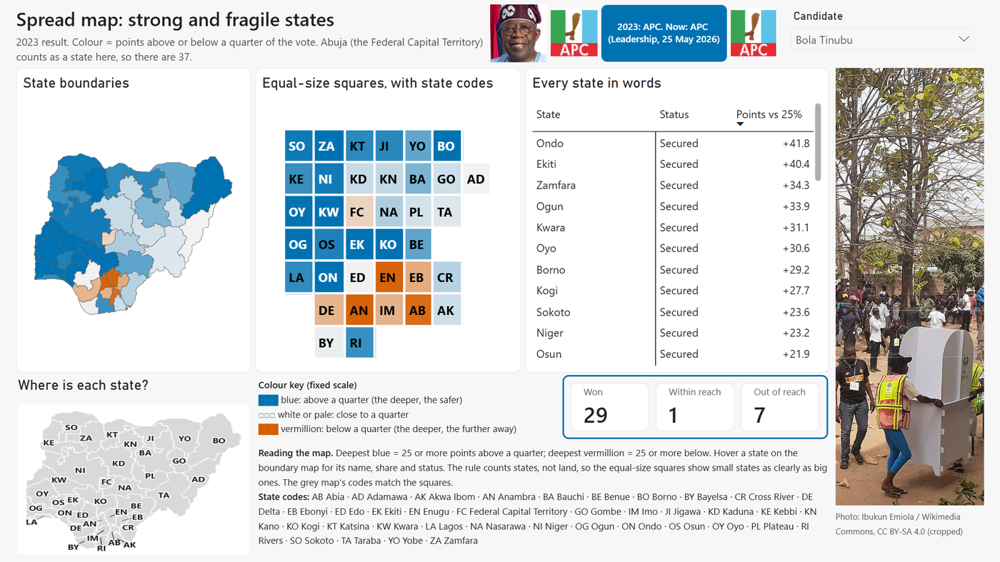
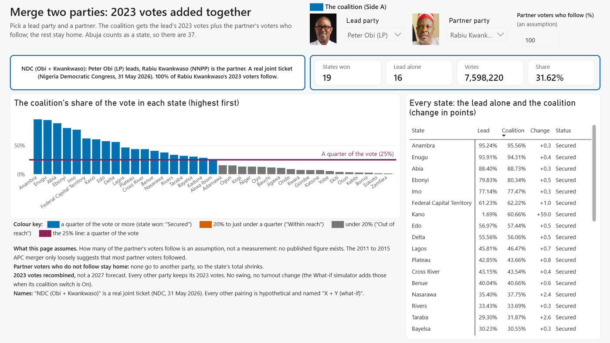
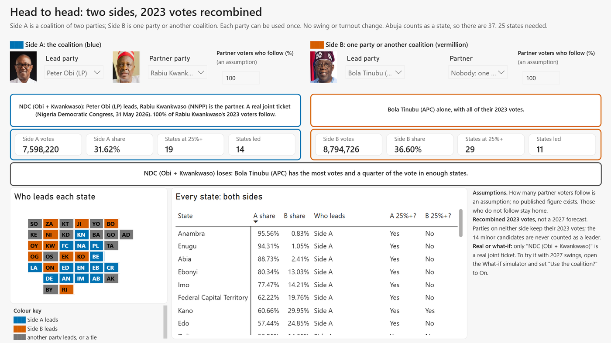
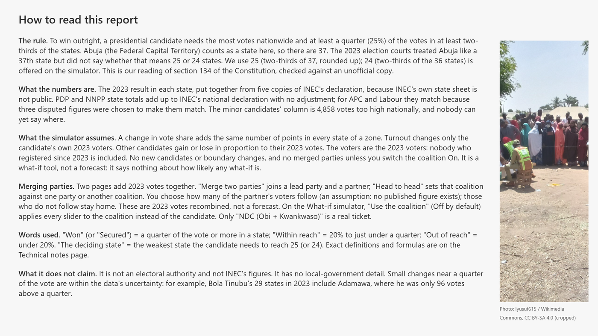
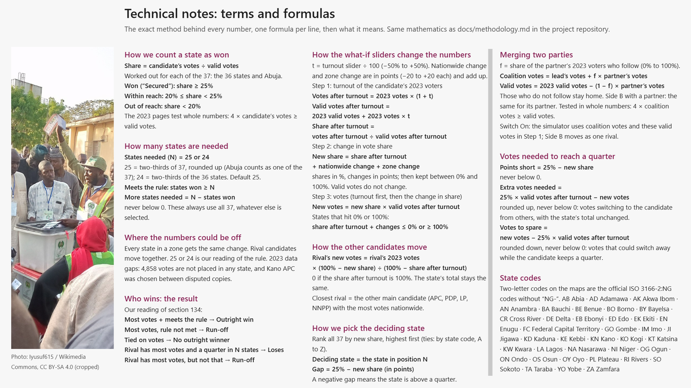
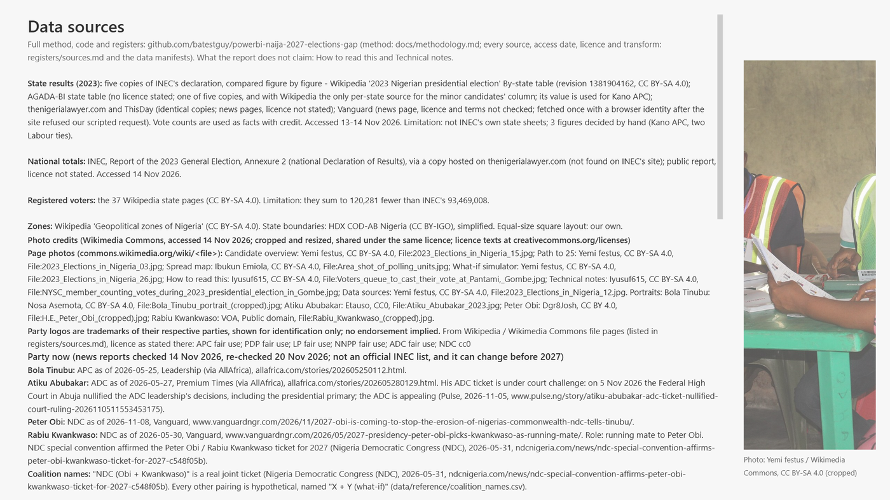

# powerbi-naija-2027-elections-gap

A Power BI what-if tool for Nigeria's 2027 presidential election.

To win outright, a candidate needs the most votes nationwide **and** at least a quarter of the vote in two-thirds of
the states and Abuja (Constitution, section 134(2)). The national vote share alone does not show how close a candidate
is to that second test. This report starts from each main candidate's 2023 result in the 37 states (Abuja, the Federal
Capital Territory, counted as a state). You can then move turnout and swing sliders, or merge two parties, and watch the
count of states at a quarter change.

The 2023 election courts treated Abuja like a 37th state but did not say whether that means 24 or 25 states. The
report uses 25 (two-thirds of 37, rounded up) and lets you switch to 24.

[](docs/demo/naija_demo.mp4)

▶ **[Watch the 3:41 demo](docs/demo/naija_demo.mp4)**: every page, recorded live in Power BI Desktop: hovers on the
charts, maps and squares, the candidate picker, swing and turnout sliders, the 25-or-24 rule, the coalition switch, the
follow rate and a 2 v 2 head to head. Music: *Darkness* by The Police.


**Status:** released as [v1.1.0](../../releases/tag/v1.1.0) (27 Nov 2026): adds "Voters comeback" sliders on Head to head and names the simulator's closest rival under their party today. First release [v1.0.0](../../releases/tag/v1.0.0) (21 Nov 2026). Scripted checks pass; a screen-reader check was done by the author. Still to do: keyboard-only and non-specialist tests, and opening the `.pbix` on a clean Windows profile. Where the project stands:
[`docs/HANDOFF.md`](docs/HANDOFF.md). Plan and exit checks: [`docs/PLAN.md`](docs/PLAN.md). One-page case study:
[`docs/case-study.md`](docs/case-study.md).

## What it can be used for
- **Explaining the rule.** The two-part win rule is often misread as "most votes wins". Each page shows the 25% line,
  the states above and below it, and the one state that decides the count. Uses: newsrooms, fact-checkers, civic
  educators and classrooms.
- **Testing "what if" claims.** Statements like "a 3-point swing in the North West changes everything" or "if Obi and
  Kwankwaso combine, they win" can be put into the sliders. The result appears as a plain sentence with the votes
  involved.
- **Studying coalitions.** The "Merge two parties" and "Head to head" pages add one party's 2023 voters to another's,
  with a slider for how many follow. Uses: analysts, researchers, and students of party alliances.
- **Spotting fragile and strong states.** The map, the tile map and the ranked charts show which states are safely
  above a quarter, which are within 5 points, and which are far below.
- **A template for reproducible election work.** Every table traces to a dated source and every page is built by a
  script, so the same pipeline can be pointed at other elections or other rules. Power BI learners can use it as a
  worked example of a report built entirely from code (PBIP/PBIR) and checked by scripts.

**What it is not:** a forecast, a poll, or an electoral authority. Slider results are assumptions made visible. See
[What it does not claim](#what-it-does-not-claim).

## The pages
The candidate picker at the top of each page switches every figure to Bola Tinubu (APC), Atiku Abubakar (PDP), Peter
Obi (LP) or Rabiu Kwankwaso (NNPP).

| Page | What it shows |
|---|---|
| **Candidate overview** | 2023 votes, share, national place and states won; every state ranked against the 25% line; zone totals; the narrowest state won and the narrowest miss, in votes. |
| **Path to 25** | The states that count: how many are needed, how many are won, the deciding state (the 25th strongest), and the votes each state needs to reach a quarter. |
| **Spread map** | A state boundary map and an equal-size tile map coloured by points above or below 25%, with a state table and a won / within reach / out of reach count. |
| **What-if simulator** | Supporter turnout, a national swing and six zone swings; 25 or 24 states; an optional coalition switch. The result is a sentence plus counts, the deciding state and a tile map. |
| **Merge two parties** | A lead party plus a partner and the share of the partner's 2023 voters who follow. The coalition's share in every state and its change from the lead alone. |
| **Head to head** | A coalition against one party or another coalition: who leads each state, who reaches a quarter, and who would win. |
| **How to read this** | Plain-words guide to the rule, the sliders and the limits. |
| **Technical notes** | Formulas in words, the deciding-state method, the coalition method, and where the numbers could be off. |
| **Data sources** | Every source with its date and licence, photo credits, and the logo notice. |

Page by page details: [`docs/page-guide.md`](docs/page-guide.md). Method: [`docs/methodology.md`](docs/methodology.md).

### Screenshots
All screenshots show the saved starting point: Bola Tinubu, every slider at 0, rule 25 states, coalition preset
"NDC (Obi + Kwankwaso)".

**Candidate overview.** Tinubu reached a quarter in 29 states in 2023, with Adamawa the narrowest by about 96 votes.


**Path to 25.** Gombe is the deciding state, 3.7 points above a quarter.


**Spread map.** Boundary map, equal-size tiles with state codes, and a grey locator map.


**Merge two parties.** Obi (LP) with all of Kwankwaso's (NNPP) 2023 voters reaches a quarter in 19 states, against 16
for Obi alone.


**Head to head.** The same coalition against Tinubu alone: 19 states at a quarter against 29, so the coalition loses on
2023 votes.


<details>
<summary>The three text pages (How to read this, Technical notes, Data sources)</summary>




</details>

## Open it

### Offline HTML in a browser

- **[Download the silent edition](https://github.com/batestguy/powerbi-naija-2027-elections-gap/releases/download/v1.1.0/NaijaElectionsGap.html)** (1.5 MB).
- **[Download the edition with Kush’s recording](https://github.com/batestguy/powerbi-naija-2027-elections-gap/releases/download/v1.1.0/NaijaElectionsGap-with-music.html)** (12.4 MB).

Open the file in Brave, Chrome, or Edge. It has all nine report tabs, maps, and working what-if and coalition controls.
It runs offline and requires no Power BI installation or account. On a phone, landscape gives you more room. The desktop
layout scrolls sideways on narrow screens.

To rebuild it, download the [frozen 2023 data ZIP](https://github.com/batestguy/powerbi-naija-2027-elections-gap/releases/download/v1.0.0/naija-elections-data-2026-11-20.zip)
from the v1.0.0 release and place it in `release/` without extracting it. From the repository root, run with Python 3.12:

```sh
python -I scripts/build_offline_elections.py --data-vintage release/naija-elections-data-2026-11-20.zip
```

**Soundtrack edition.** Sound starts off. The **Sound off** button starts the loop, and **Sound on** pauses it. The song
continues across tabs. The Data sources tab credits “Let’s Live Together” by Kush, from *The Experience*,
℗ 2003 DKG Music, Inc. To rebuild this edition with a local copy of the recording, add
`--kush-soundtrack "path/to/track.m4a"` to the build command. [Recording credit](https://www.youtube.com/watch?v=kL2s76KoNCo)

### Power BI Desktop on Windows

Needs Power BI Desktop (free, Windows). Built and tested with the Microsoft Store edition, version 2.159, November 2026.

- **Quickest:** download `NaijaElectionsGap.pbix` from the latest release and open it in Power BI Desktop. The data
  is inside the file. A data refresh looks for the tables in `D:\PowerBiElections2026Naija\data\staging`. To refresh
  elsewhere, unzip the release's data vintage and point the `DataFolder` parameter (Transform data > Edit parameters)
  at its `staging` folder.
- **From source:** open `pbip/NaijaElectionsGap.pbip` (Power BI project).
- **Preview:** The screenshots above and the [demo video](docs/demo/naija_demo.mp4) show every page.

## Tools used
| Tool | Version | What it does here |
|---|---|---|
| **Power BI Desktop** (Microsoft Store edition) | 2.159 | The report itself: data model, measures, pages. Delivered as a desktop file, with no Power BI service account needed. |
| **PBIP / PBIR / TMDL** (Power BI project format) | GA in 2026 | The report saved as plain text files (model in TMDL, pages and visuals in PBIR JSON), so it lives in git and every change can be read in a diff. |
| **DAX** | | All scenario logic: swing, turnout, the whole-number 25% test, the deciding state, coalition recombination, and the result sentences. Sliders are What-If parameters, never hard-coded values. |
| **Power Query (M)** | | Loads the staging CSVs through a single `DataFolder` parameter. |
| **Shape Map visual + own TopoJSON** | | State boundary maps that work offline with no sign-in. The boundaries are HDX COD-AB, simplified in Python. |
| **Python 3.12 with uv** | CPython 3.12.13, uv 0.11 | Downloads and snapshots sources, reconciles the five result copies, builds the geometry, writes the whole Power BI project, and runs the checks. Packages: `shapely` and `topojson` (maps), `pillow` (photo crops), `openpyxl` (spreadsheet sources). |
| **Microsoft `powerbi-report-author` and `powerbi-desktop` command-line tools** | 0.5.0 / 1.0.0 (Node.js 24) | Validate the generated report files offline; reload, check and screenshot Power BI Desktop from a script. |
| **PowerShell + Desktop's local engine** (ADOMD client) | Windows PowerShell | Query and time the live model inside Desktop (`scripts/pbi_engine.ps1`), so checks run against what a reader actually sees. |
| **Git, GitHub and GitHub CLI** | gh 2.93 | Version history; releases carry the `.pbix`, the frozen data vintage and checksums. |
| **Claude Code** (Anthropic) | | AI coding assistant used to write the scripts, the generator and the documentation under the author's direction. Decisions are logged in [`registers/decision-log.md`](registers/decision-log.md). |

## Data
- **2023 state results:** five copies of INEC's declaration (a Wikipedia by-state table pinned to a revision, the
  AGADA-BI table, ThisDay, thenigerialawyer.com and Vanguard). They are reconciled cell by cell; three cells were
  decided by hand and listed with reasons. The state sums equal INEC's national totals. INEC's own state sheets are not
  public.
- **Also used:** INEC's national declaration, registered voters (Wikipedia state pages), ISO 3166-2:NG state codes, HDX
  COD-AB boundaries, dated news reports for each candidate's party now and the coalition tickets, and Wikimedia Commons
  photos.
- **Records kept for every source:** its URL, access date, licence and a SHA-256 snapshot. See
  [`registers/sources.md`](registers/sources.md) and [`docs/data-profile.md`](docs/data-profile.md).

## Rebuild from source
Python 3.12 with [uv](https://docs.astral.sh/uv/) ([`docs/environment.md`](docs/environment.md)), from the repo root:
```
uv sync
uv run python -I scripts/pull_sources.py --skip-mundx     # raw snapshots (Mundx is not redistributed)
uv run python -I scripts/build_staging.py                 # staging tables + reconciliation
uv run python -I scripts/build_geometry.py                # map files
uv run python -I scripts/build_pbip.py                    # Power BI model + pages
powerbi-report-author validate pbip/NaijaElectionsGap.Report
```
The checks and every other command: [`CLAUDE.md`](CLAUDE.md), section "Commands".

## How it is checked
Scripts query the live model and compare it with a separate re-implementation of
[`docs/methodology.md`](docs/methodology.md):
- `scripts/validate_phase3.py` checks the model.
- `scripts/validate_phase4.py` runs 92 checks on the scenario engine, including slider extremes and exact 25% boundary
  cases.
- `scripts/validate_phase6.py` runs 18 QA checks: totals against the independent copies, maps, alt text and tab order,
  fixed numbers in the page text, and speed (each visual's query on the heavy pages under 2 seconds; slowest 0.63 s).

All pass on the release build (`reports/phase4_validation.json`, `reports/phase6_validation.json`). The
re-implementation was written by the same author, so it mainly catches slips. Hover cards were checked by hand and on the demo video, and a
screen-reader check was done by the author (21 Nov 2026). Not yet done: keyboard-only use and a test with a non-specialist.

Decisions and their reasons: [`registers/decision-log.md`](registers/decision-log.md). Open questions:
[`registers/open-questions.md`](registers/open-questions.md).

## What it does not claim
- It is a scenario and communication tool, **not a forecast and not an electoral authority**.
- The 2023 state results reconcile **five copies of INEC's declaration**, not INEC's own state collation sheets.
- A swing applies the same change to every state in a zone (or nationwide). That is an approximation, stated on the
  report pages.
- The voters are the 2023 voters: nobody who registered since 2023 is modelled.
- On the coalition pages, how many partner voters follow is an assumption. Voters who don't follow stay home. Only
  "NDC (Obi + Kwankwaso)" is a real ticket; every other pairing is a what-if.
- "Party now" and coalition names come from dated news reports (re-checked 20 Nov 2026), not INEC's final list.

## Layout
```
data/        raw / staging / reference; only manifests and reference CSVs are committed (see .gitignore)
scripts/     pull, build, validate and release scripts
pbip/        Power BI project (PBIP/PBIR), generated by scripts/build_pbip.py
docs/        plan, handoff, environment, model, methodology, page guide, case study, README images
registers/   decision log, open questions, risks, sources, QA log
reports/     generated checks and screenshots
```

## How to cite
batestguy (2026). *powerbi-naija-2027-elections-gap: a what-if tool for Nigeria's 2027 presidential election*
(v1.0.0). https://github.com/batestguy/powerbi-naija-2027-elections-gap

## Licence
- **Code:** MIT ([`LICENSE`](LICENSE)).
- **Data:** each source keeps its own terms; see [`registers/sources.md`](registers/sources.md). Mundx data (used only
  to check accuracy) is not redistributed.
- **Photos and portraits:** Wikimedia Commons, free licences only (CC0, public domain, CC BY, CC BY-SA). Credits are
  on the report's Data sources page.
- **Party logos:** trademarks of their parties, shown for identification only; no endorsement implied. Build with
  `PBIP_NO_LOGOS=1` to show abbreviation badges instead.
