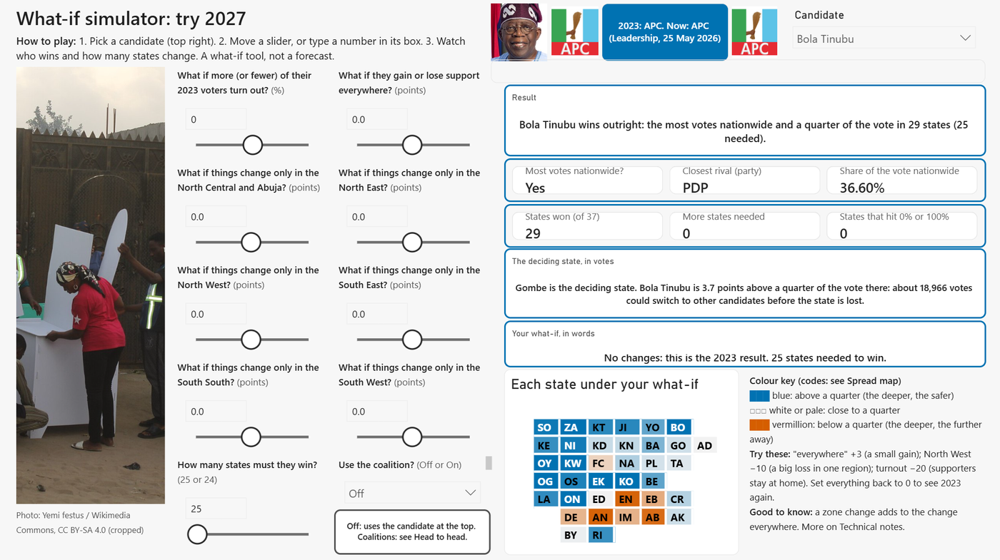

# powerbi-naija-2027-elections-gap

A Power BI what-if tool for Nigeria's 2027 presidential election. It starts from each main candidate's 2023 result
in the 37 states (Abuja, the Federal Capital Territory, counted as a state), lets you move turnout and swing sliders,
and counts the states where the candidate reaches a quarter of the vote. The constitution asks for a quarter of the
vote in two-thirds of the states. The 2023 election courts treated Abuja like a 37th state but did not say whether that
means 24 or 25 states; the report uses 25 (two-thirds of 37, rounded up) and lets you switch to 24.



**Status:** built; scripted checks pass; person checks (keyboard, screen reader, a non-specialist test) and the
walkthrough video are pending. First release in preparation (see [Releases](../../releases)). Where the project
stands: [`docs/HANDOFF.md`](docs/HANDOFF.md). Plan and exit checks: [`docs/PLAN.md`](docs/PLAN.md). One-page case study: [`docs/case-study.md`](docs/case-study.md).

## Open it
Needs Power BI Desktop (free, Windows; built and tested with the Microsoft Store edition, November 2026).

- **Quickest:** download `NaijaElectionsGap.pbix` from the latest release and open it in Power BI Desktop (free,
  Windows). The data is inside the file. A data refresh looks for the tables in `D:\PowerBiElections2026Naija\data\staging`;
  to refresh elsewhere, unzip the release's data vintage and point the `DataFolder` parameter at its `staging` folder.
- **From source:** open `pbip/NaijaElectionsGap.pbip` (Power BI project).

## Rebuild from source
Python 3.12 with [uv](https://docs.astral.sh/uv/) ([`docs/environment.md`](docs/environment.md)), from the repo root:
```
uv sync
uv run python -I scripts/pull_sources.py --skip-mundx     # raw snapshots (Mundx is not redistributed)
uv run python -I scripts/build_staging.py                 # staging tables + reconciliation
uv run python -I scripts/build_geometry.py                # map files
uv run python -I scripts/build_pbip.py                    # Power BI model + pages
```
The checks and every other command: [`CLAUDE.md`](CLAUDE.md), section "Commands".

## Report pages
Candidate overview · Path to 25 · Spread map · What-if simulator (with a "Use the coalition" switch, Off by default) ·
Merge two parties · Head to head · How to read this · Technical notes · Data sources. Details:
[`docs/page-guide.md`](docs/page-guide.md). The two coalition pages recombine 2023 votes (lead + the share of a
partner's voters who follow; the rest stay home); only "NDC (Obi + Kwankwaso)" is a real ticket, every other pairing
is a what-if. Method: [`docs/methodology.md`](docs/methodology.md).

## What this is not
- A scenario and communication tool, **not a forecast and not an electoral authority**. Slider results are
  assumptions made visible.
- The 2023 state results reconcile **five copies of INEC's declaration**, not INEC's own state collation sheets
  (not public). Three cells were decided by hand and are listed.
- A swing applies the same change to every state in a zone (or nationwide). That is an approximation, stated on the
  report pages.
- The voters are the 2023 voters: nobody who registered since 2023 is modelled.
- "Party now" and coalition names come from dated news reports (re-checked 20 Nov 2026), not INEC's final list.

## How it is checked
Scripts query the live model and compare it with a separate re-implementation of
[`docs/methodology.md`](docs/methodology.md) (written by the same author, so it mainly catches slips):
`scripts/validate_phase3.py` (model), `scripts/validate_phase4.py` (scenario engine, 92 checks),
`scripts/validate_phase6.py` (QA: totals vs independent copies, maps, accessibility text, speed; 18 checks). Not yet
done: hover cards, keyboard and screen-reader use, and a test with a non-specialist. Results:
`reports/phase4_validation.json`, `reports/phase6_validation.json`. Decisions and their reasons:
[`registers/decision-log.md`](registers/decision-log.md); open questions: [`registers/open-questions.md`](registers/open-questions.md).

## Layout
```
data/        raw / staging / reference; only manifests and reference CSVs are committed (see .gitignore)
scripts/     pull, build, validate and release scripts
pbip/        Power BI project (PBIP/PBIR), generated by scripts/build_pbip.py
docs/        plan, handoff, environment, model, methodology, page guide
registers/   decision log, open questions, risks, sources, QA log
reports/     generated checks and screenshots
```

## How to cite
batestguy (2026). *powerbi-naija-2027-elections-gap: a what-if tool for Nigeria's 2027 presidential election*
(v1.0.0). https://github.com/batestguy/powerbi-naija-2027-elections-gap

## Licence
Code: MIT ([`LICENSE`](LICENSE)). Data: each source keeps its own terms; see
[`registers/sources.md`](registers/sources.md). Mundx data (used only to check accuracy) is not redistributed.
Photos and portraits: Wikimedia Commons, free licences only (CC0, public domain, CC BY, CC BY-SA); credits on the
report's Data sources page. Party logos are trademarks of their parties, shown for identification only; no
endorsement implied. Build with `PBIP_NO_LOGOS=1` to show abbreviation badges instead.
