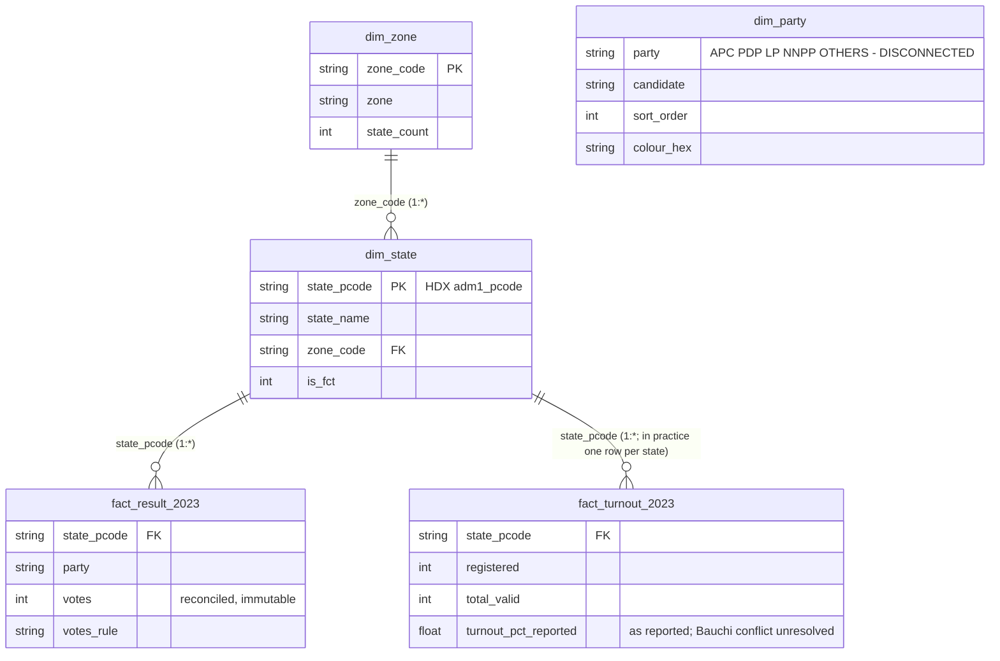

# Semantic model (Phase 3)

Built by `scripts/build_pbip.py` into `pbip/NaijaElectionsGap.SemanticModel/` (TMDL). Checked against the live model
inside Power BI Desktop by `scripts/validate_phase3.py` → `reports/phase3_validation.json` (12 checks: 11 pass, 0 fail, 1 info).

## Diagram



All relationships are many-to-one and filter in one direction (dimension → fact). No bidirectional filters.

## Tables and grain

| Table | Grain | Rows | Source |
|---|---|---|---|
| `dim_zone` | geopolitical zone | 6 | `data/staging/dim_zone.csv` |
| `dim_state` | state (36 + FCT) | 37 | `data/staging/dim_state.csv`; key = HDX `adm1_pcode`, same key as both TopoJSON maps |
| `dim_party` | candidate | 5 | `data/reference/party_display.csv` (own design) |
| `fact_result_2023` | state × party | 185 | reconciled 2023 baseline (`docs/data-profile.md`); never modified by scenarios |
| `fact_turnout_2023` | state | 37 | registered voters, valid votes, reported turnout % (Bauchi: 31.1% here vs 32.73% on its state page — unresolved) |

Data is imported from `data/staging/*.csv` through one Power Query parameter, `DataFolder`. Nothing is typed into the model by hand.

## Design choices

- **Geography is the spine.** Every fact joins to `dim_state` on the P-code, which is also the key in both Shape Map files. One key, no name matching inside the model.
- **`dim_party` is disconnected on purpose.** If a candidate selection filtered the fact tables directly, it would also filter
  the valid-vote total (the denominator) or hide other candidates' rows. Measures read the selection with
  `SELECTEDVALUE(dim_party[party])` instead. Checked: selecting APC or LP leaves `Valid votes` unchanged.
- **Baseline facts are immutable.** Scenario logic (Phase 4) will live only in measures and What-If parameters, never in fact columns.
- **The 25% test is a measure**, not a stored flag: `States at 25% or more` counts **units — 36 states plus the FCT, 37 in
  all** (decision log 2026-11-13; open question 1 on the constitutional wording is still partly open) — where the
  candidate has at least one-quarter of valid votes. It is tested in whole numbers (4 × votes ≥ valid votes), so no
  rounding at the boundary. Without the FCT, LP's count is 15, not 16; the other candidates do not change
  (`reports/phase3_validation.json`, info entry). It is blank for OTHERS (not a candidate).
- **A missing state is never silently counted as "below 25%".** `States with a computable share` counts the units where
  the test could be applied (37 today for every candidate) and must be shown next to the 25% count.
- **Columns not loaded:** accredited voters (0 of 37 states have it), rejected votes and total cast (1 of 37). Loading empty
  columns would invite visuals that look complete but are not.
- **Colours:** Okabe-Ito colour-blind-safe palette, not party brand colours.

## Measures (in `fact_result_2023`)

| Measure | Meaning |
|---|---|
| `Total votes` | Sum of votes in the current filter |
| `Valid votes` | Sum of total valid votes (per state = reconciled four parties + OTHERS) |
| `Candidate votes` / `Candidate share` | Votes and share of valid votes for the candidate selected in `dim_party` |
| `States at 25% or more` | Number of units (36 states + FCT) where the selected candidate has ≥ 25% of valid votes |
| `States with a computable share` | Units where that test could be applied (votes and valid votes present) |
| `APC votes` / `APC share` | Fixed-to-APC versions used by the thin-slice page |

## Known effect of the data gaps on measures

`Valid votes` nationally is 24,030,798, which is 4,858 more than INEC's declared 24,025,940. That is the unlocated
OTHERS excess (see `docs/data-profile.md`). So national shares come out a hair lower than INEC's: APC 36.598% here vs
36.605% from INEC's own totals (both in `reports/phase3_validation.json`, info entry). Per-state shares carry the same
uncertainty.

**The 25% count of 29 / 21 / 16 / 1 is what the current data gives, not a settled fact.** APC's 29 rests on a 96-vote
margin in Adamawa, and the 4,858-vote excess sits in the denominators; PDP's 21 depends on the Zamfara cell; Kano APC
is a constraint-based choice. See "Close calls for the 25% rule" in `docs/data-profile.md` — the report must show
these margins wherever the count appears.

## What this model does not claim

It does not contain LGA data, scenario logic, or any official INEC state sheet. Vote counts per state are the
reconciled reading described in `docs/data-profile.md`.

## Re-run and check

```
uv run python -I scripts/build_pbip.py
powershell -NoProfile -ExecutionPolicy Bypass -File scripts/pbi_reopen.ps1 -Force   # reopen Desktop + refresh data
uv run python -I scripts/validate_phase3.py --no-refresh
```

## Scenario layer (Phase 4)

Method: `docs/methodology.md`. Nine disconnected What-If tables hold the slider values (`param_turnout`,
`param_swing_national`, `param_swing_NC` … `param_swing_SW`, `param_rule`); each has a `<table> value` measure.
All scenario logic is in measures of the `scenario` table (`Scenario share`, `Units secured`, `Tipping-point unit`, …).
No scenario value is stored in any fact table. Checked against a re-implementation of the note
(`reports/phase4_validation.json`) and a blind reproduction by a reviewer (`registers/qa-log.md`).
*Clears the rule*, *Units still needed* and the *Tipping-point* measures always use all 37 units; the unit counts follow page filters.
